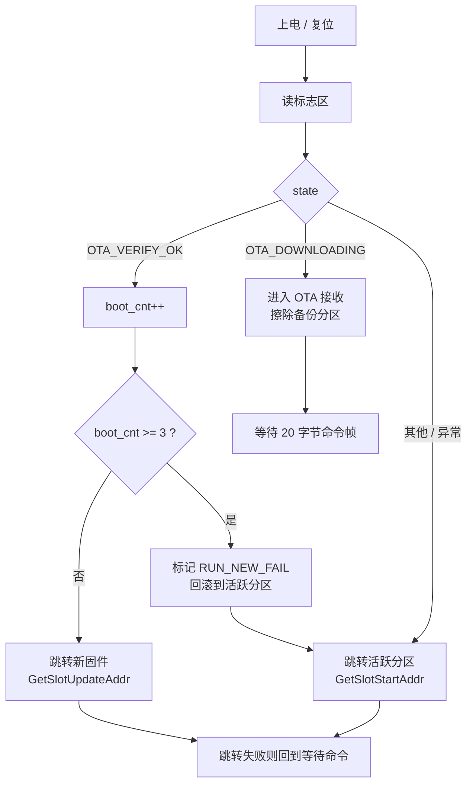

# STM32 OTA BootLoader（串口 + A/B 双分区）

基于 STM32F103 的串口 OTA 升级方案。BootLoader 通过 USART1 接收上位机发来的 `.bin` 固件，
逐包校验 CRC32 后写入备份分区，重启后从新分区运行；新固件连续启动失败会自动回滚到旧分区。

上位机是一个命令行 Python 脚本（`tools/ota_upload.py`），不需要图形界面。

---

## 快速开始

```bat
:: 1) 看串口
py tools\ota_upload.py --list

:: 2) 升级（波特率要和固件 uart1_init() 一致）
py tools\ota_upload.py COM6 app.bin -b 230400
```

---

## 硬件与环境

| 项目 | 说明 |
|---|---|
| MCU | STM32F103C8T6（64 KB Flash / 20 KB RAM） |
| 主频 | 8 MHz 外部晶振 → PLL 72 MHz |
| 串口 | USART1，`PA9 = TX`、`PA10 = RX`，8N1，无流控 |
| 波特率 | 默认 **230400**（编译期写在 `main.c` 的 `uart1_init()` 里） |
| 编译 | Keil MDK 5（ARMCC V5.06），工程 `Projects/MDK-ARM/stm32f103.uvprojx` |
| 上位机 | Python 3 + `pyserial`（`py -m pip install pyserial`） |

---

## Flash 分区

| 区域 | 起始地址 | 大小 | 说明 |
|---|---|---|---|
| BootLoader | `0x08000000` | 16 KB | 本工程，上电先运行 |
| APP A | `0x08004000` | 23 KB (`0x5C00`) | A 区应用 |
| APP B | `0x08009C00` | 23 KB (`0x5C00`) | B 区应用（升级备份） |
| 标志区 | `0x0800F800` | 2 KB | OTA 状态、CRC、启动计数 |

```
0x08000000 ┌──────────────┐
           │  BootLoader  │ 16 KB
0x08004000 ├──────────────┤
           │    APP A     │ 23 KB
0x08009C00 ├──────────────┤
           │    APP B     │ 23 KB
0x0800F800 ├──────────────┤
           │   标志区      │ 2 KB
0x08010000 └──────────────┘
```

单分区最大固件 **23552 字节**，超过会被上位机拦下或板子拒绝。

---

## 启动流程

上电后 BootLoader 先读标志区，再按状态决定动作：



标志区结构（`OTA_FlagTypeDef`）：

```c
typedef struct {
    OTA_State_t state;      // 0xAA IDLE / 0xBB DOWNLOADING / 0xCC VERIFY_OK / 0xDD RUN_NEW_FAIL
    uint8_t     active_slot;// SLOT_A(0) / SLOT_B(1)
    uint32_t    new_app_crc;// 新固件整片 CRC32
    uint32_t    app_len;    // 新固件长度
    uint32_t    boot_cnt;   // 新固件启动计数
} OTA_FlagTypeDef;
```

- 升级成功：`state = VERIFY_OK`，复位。
- 新固件启动后必须调用 `OTA_ConfirmIfNeeded()`：把 `state` 改回 `IDLE`、`boot_cnt` 清零、
  `active_slot` 改成自己所在的分区。**这是“升级成功”的确认动作**。
- 如果新固件一直不确认，`boot_cnt` 每次加 1，达到 3 次就标记失败并回滚到旧分区。

---

## OTA 协议

### 命令帧（20 字节）

```
A5 5A 01 | app_len(4) | 总包数(2) | 每包长度(2) | ver(1) | 整片CRC32(4) | 帧CRC32(4)
 字节0~2     3~6         7~8          9~10        11        12~15         16~19
```

| 字段 | 字节序 |
|---|---|
| `app_len`、总包数、每包长度、整片 CRC32 | **大端** |
| 帧 CRC32（前 16 字节的 CRC32） | **小端** |

> 末尾这个 CRC 是唯一的小端字段，固件按小端读取（`bootloader.c` 中 `recv_crc` 的拼装）。
> 写成大端会得到 `cmd CRC error`。

### 数据帧

```
A5 | seq(2) | len(2) | data(len 字节) | CRC32(4)
```

- 多字节字段全部**小端**，`seq` 从 1 开始，`len` 取值 1~512。
- CRC32 覆盖 `A5 + seq + len + data`。
- 一帧最长 `5 + 512 + 4 = 521` 字节，正好等于固件的 DMA 缓冲 `UART1_RX_BUF_SIZE`。

### 板子应答（单字节）

| 字节 | 含义 | 上位机动作 |
|---|---|---|
| `0x11` | READY，擦除完成 | 开始发第 1 包 |
| `0x06` | ACK，本包已写入 Flash | 发下一包 |
| `0x15` | NAK，序号或 CRC 错 | 重发当前包 |
| `0x12` | DONE，最后一包收完 | 等整片校验结果 |
| `0x13` | OK，整片 CRC 通过 | 成功，板子随后复位 |
| `0x14` | FAIL，命令被拒 / 越界 / 校验失败 | 失败 |

CRC32 为标准 zlib / IEEE 802.3 算法（初值 `0xFFFFFFFF`，多项式 `0xEDB88320`，结果取反），
与上位机 `zlib.crc32()` 完全一致。

### 升级时序

```
PC                                   STM32 BootLoader
 │  20 字节命令帧  ─────────────────►  校验帧头 + CRC
 │                                    擦除备份分区
 │  ◄───────────────────── 0x11 READY
 │  数据帧 seq=1  ──────────────────►  校验 CRC → 写 Flash
 │  ◄──────────────────────── 0x06 ACK
 │  ...（每包都等 ACK，超时/NAK 重发）...
 │  数据帧 seq=N  ──────────────────►
 │  ◄─────────────── 0x12 DONE + 0x06 ACK
 │                                    整片 CRC32 校验
 │  ◄──────────────────── 0x13 OK      复位
```

- 停等协议：一次只发一包，收到 ACK 才发下一包。
- 同一包重复到达时（ACK 丢失后重发），板子只回 ACK，不会重复写 Flash。
- 掉电或断线后重新上电，`DOWNLOADING` 状态会被启动流程清成 `IDLE`。

---

## 目录结构

```
.
├── Drivers/
│   ├── BSP/interface/        bootloader.c/h —— OTA 核心（组帧、写 Flash、跳转）
│   ├── SYSTEM/uart1/         USART1 + DMA 初始化
│   ├── SYSTEM/delay|sys/     时钟、延时
│   ├── BSP/led/              LED 驱动
│   └── STM32F1xx_HAL_Driver/ ST 官方 HAL
├── Users/
│   ├── main.c                启动流程、状态判断、OTA 主循环
│   └── stm32f1xx_it.c        中断入口
├── Projects/MDK-ARM/         Keil 工程
├── tools/
│   ├── ota_upload.py         命令行升级工具
│   └── stm32_baud.py         波特率误差计算器
└── Output/                   编译产物（已被 .gitignore 忽略）
```

---

## 编译与烧录

### Keil 图形界面

打开 `Projects/MDK-ARM/stm32f103.uvprojx` → Build → Download。

### 命令行

```bat
:: 只编译
"F:\tools\UV4\UV4.exe" -b "...\Projects\MDK-ARM\stm32f103.uvprojx" -j0 -t Template -o build.log

:: 编译并烧录（-f 会执行 Flash Download）
"F:\tools\UV4\UV4.exe" -f "...\Projects\MDK-ARM\stm32f103.uvprojx" -j0 -t Template -o build.log
```

产物：`Output\stm32f103.axf / .hex / .bin`。

---

## 上位机使用

```bat
:: 列出串口
py tools\ota_upload.py --list

:: 不接板子，自检 CRC32 和组帧
py tools\ota_upload.py --selftest

:: 升级（端口 + 固件 + 波特率）
py tools\ota_upload.py COM6 app.bin -b 230400

:: 可选参数
--payload 512        每包长度（必须和固件一致）
--retry 5            每包最多重发次数
--ack-timeout 2.0    等 ACK 的超时
--wait 30            等板子启动打印的秒数
```

脚本行为：

1. 打开串口，等板子打印启动信息（收到任意数据即认为板子已启动）。
2. 发 20 字节命令帧，等 `0x11`。
3. 逐包发送，每包等 `0x06`，超时或 `0x15` 自动重发。
4. 等 `0x13` / `0x14`，打印结果和总耗时。

> 板子必须先处于 BootLoader 的等待窗口（上电后 5 秒内），否则收不到启动打印。
> 当前工程在 APP 有效时上电会直接跳 APP，见文末“已知问题”。

---

## 制作 APP 固件的注意事项

OTA 只会把固件写进**非活跃分区**，所以固件的链接地址必须和这次写入的分区一致：

| 目标分区 | Keil IROM1 起始 | `SCB->VTOR` | 运行后 `active_slot` |
|---|---|---|---|
| A 区 | `0x08004000` | `0x08004000` | `SLOT_A` |
| B 区 | `0x08009C00` | `0x08009C00` | `SLOT_B` |

APP 的 `main()` 开头：

```c
SCB->VTOR = 0x08004000U;   // A 区；B 区写 0x08009C00
HAL_Init();
...
OTA_ConfirmIfNeeded();     // 升级后第一次运行必须调用，负责“确认升级”
```

其他要求：

- 输出裸 `.bin`（不是 `.hex`）。
- 大小 ≤ 23552 字节。
- 如果 APP 用到中断，`VTOR` 必须在开中断之前设置好。

---

## 测试方法

1. **离线自检**：`py tools\ota_upload.py --selftest`
   期望 `crc32("123456789") = 0xCBF43926`，命令帧 20 字节。
2. **链路检查**：`py tools\ota_upload.py COM6` 不带固件时先看启动打印是否正常、有无乱码。
3. **命令帧**：升级时能收到 `0x11`；若板子打印 `cmd CRC error`，说明命令帧格式/字节序不对。
4. **逐包**：观察是否有大量“重发”，偶发 1~2 次属正常。
5. **整片校验**：末尾应出现 `CRC32=xxxxxxxx target=xxxxxxxx` 且两者一致。
6. **运行验证**：看 APP 的 LED / 串口输出是否正常。

波特率对比测试的思路：同一份固件分别在不同 `uart1_init()` 下重编 BootLoader，
用 `tools/stm32_baud.py 72 <baud>` 先确认误差，再连续跑多次升级统计成功率和耗时。
72 MHz 下的常用档位：

```
115200  误差 0%       230400  误差 +0.16%    460800  误差 +0.16%
500000  误差 0%       921600  误差 +0.16%    1000000 误差 0%
```

---

## 已知问题（重要）

1. **`ACTIVE_SLOT` 宏是反的**

   ```c
   #define ACTIVE_SLOT temp_flag.active_slot == 1 ? A : B   // 实际在 A 时打印 "B"
   ```

   建议改成：

   ```c
   #define ACTIVE_SLOT (temp_flag.active_slot == SLOT_A ? A : B)
   ```

2. **B 区 APP 的确认函数写死了 A 区**

   `1. STM32_流水灯实验`（B 区工程）里 `OTA_ConfirmIfNeeded()` 仍然把
   `active_slot` 设成 `SLOT_A`，B 区固件应改成 `SLOT_B`，否则下次上电会跳回旧 APP。

3. **APP 有效时没有升级窗口**

   当前启动流程在 `IDLE` 状态下直接跳 APP，所以一旦 APP 有效，上电就进不去 OTA，
   只能擦掉 APP 分区再升。若要方便反复升级，可在跳转前加 3~5 秒等待窗口。

4. **波特率是编译期固定的**

   改 `uart1_init()` 后必须重新编译并烧录 BootLoader，上位机也要用同样的 `-b`。

5. **A/B 分区需要两份链接地址不同的固件**

   当前方案不是位置无关代码，A 区固件不能直接跑在 B 区（会报 `reset handle error`）。

---

## 版本记录

- `9da0d2d` 移除重复的 DMA 初始化；跳转前恢复全局中断；IWDG 改为进入 OTA 才启动；适配命令行升级脚本
- `f034106` 注释中文化
- `71d031e` 分区边界检查、跳转失败兜底、APP 确认参考
- `371ed91` 逐包 CRC32 校验 + 停等重传
- `c640ec6` 初始提交：逐包 CRC 改造前的原始基线
